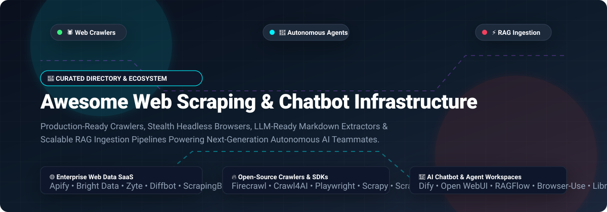

  

# 🌐 Awesome Web Scraping & Chatbot Infrastructure 🤖

### *Curated Directory of Cloud SaaS Platforms, Headless Browser Engines, AI-Ready Web Crawlers & Chatbot RAG Ingestion Systems*

---

## 📑 Table of Contents
- [🎯 Overview & Architecture](#-overview--architecture)
- [📊 Sector Overview & Market Dynamics](#-sector-overview--market-dynamics)
- [💼 SaaS & Hosted Cloud Platforms](#-saas--hosted-cloud-platforms)
- [🔓 Open-Source GitHub Projects](#-open-source-github-projects)
- [📈 Star History](#-star-history)
- [💖 Support & Sponsorship](#-support--sponsorship)
- [🤝 How to Contribute](#-how-to-contribute)
- [📜 License](#-license)
- [⚠️ Disclaimer](#-disclaimer)

---

## 🎯 Overview & Architecture

Modern AI workflows, Retrieval-Augmented Generation (RAG) chatbots, and persistent AI coworkers demand reliable, real-time data ingestion pipelines. This repository (`Awesome-Web-Scraping-Chatbot-Infrastructure`) curates industry-leading **enterprise SaaS platforms** and **cutting-edge open-source projects** engineered to:
- 🕷️ **Crawl & Traverse**: Extract complex single-page applications (SPAs), infinite scroll interfaces, and authenticated dashboards.
- ⚡ **Convert to LLM-Ready Markdown**: Parse messy HTML DOM trees into clean, noise-free Markdown, semantic chunks, and structured JSON schemas.
- 🛡️ **Bypass Anti-Bot Detection**: Route requests through dynamic residential proxies, CAPTCHA solvers, and TLS/JA3 browser fingerprint emulators.
- 💬 **Ingest into Chatbot & RAG Memory**: Pipe live web knowledge directly into vector databases, conversational agents, and autonomous AI teammate runtimes.

---

## 📊 Sector Overview & Market Dynamics

The global web data extraction and chatbot infrastructure sector is valued at approximately **$4.9 billion in 2024 and projected to exceed $14.2 billion by 2030**, expanding at a Compound Annual Growth Rate (CAGR) of over 19.4% driven by exponential enterprise demand for LLM web grounding and real-time RAG ingestion.

The sector exhibits **moderate fragmentation with strong consolidation in proxy infrastructure alongside high fragmentation in LLM crawling/agent layers**: while enterprise proxy networks and compliance-heavy managed data collection are concentrated among a few infrastructure leaders (such as Bright Data and Zyte), the AI-native crawler and autonomous browser agent ecosystems remain intensely competitive, open-source driven, and rapidly evolving.

---

## 💼 SaaS & Hosted Cloud Platforms

The table below lists leading managed web scraping, headless browser clouds, and LLM-ready ingestion platforms, sorted in descending order by **Company Size / Estimated Valuation / Revenue**:

| 🏢 Platform | 💰 Starting Tier Price | 🎁 Free Tier / Free Trial Limits | 📈 Company Scale (Valuation / Revenue) | 🔍 Key Capabilities & Focus |
|:---|:---|:---|:---|:---|
| **[Bright Data](https://brightdata.com)** | **$500/month** (Micro-Package; Pay-As-You-Go starts at $8.40/GB residential) | **7-day free trial** with **$5 trial credit** for verified business domains | **~$1.5B valuation** (Majority acquired by EMK Capital; ~$150M+ ARR) | Global residential proxy network (72M+ IPs), Scraping Browser with built-in unblocking, SERP API, and AI dataset feeds. |
| **[Zyte (formerly Scrapinghub)](https://zyte.com)** | **$29/month** (Starter tier for Zyte API data extraction) | **30-day free trial** with **$5 free usage credit** | **~$100M+ valuation** (~$35M - $45M estimated annual revenue) | Creators of Scrapy; AI automatic unblocking engine, Scrapy Cloud hosting, headless browser rendering, and compliance scrapers. |
| **[Diffbot](https://diffbot.com)** | **$299/month** (Startup Plan for Extract APIs) | **14-day free trial** with **10,000 free credits** | **~$150M valuation** ($10M Series A; ~$15M - $25M ARR) | Computer vision & NLP web extraction that turns entire sites into structured Knowledge Graph entities and clean JSON. |
| **[Apify](https://apify.com)** | **$49/month** (Starter Plan for actors & compute) | **Free Forever plan** with **$5 free usage compute credit / month** | **~$50M - $80M valuation** (~$15M ARR) | Serverless cloud web scraping ecosystem, 2,000+ pre-built Actors, RAG web browsers, and MCP agent connectors. |
| **[Import.io](https://import.io)** | **$199/month** (Starter plan; Custom Enterprise tiers) | **14-day free trial** with **1,000 page extractions limit** | **~$60M valuation** ($38M+ raised; acquired Connotate) | Enterprise Web Data Integration (WDI) platform converting web portals into automated machine-readable data pipelines. |
| **[Octoparse](https://octoparse.com)** | **$89/month** (Standard Plan billed annually) | **Free Forever plan** with **10 concurrent tasks & unlimited pages** (local execution only) | **~$30M - $50M valuation** (~$10M - $15M estimated revenue) | Visual point-and-click no-code scraper with cloud scheduling, anti-tracking IP rotation, and automated export templates. |
| **[ScraperAPI](https://scraperapi.com)** | **$49/month** (Hobby plan for 100,000 API credits) | **7-day free trial** with **5,000 free API credits** | **~$25M - $40M valuation** (Bootstrapped/Private Equity backed; ~$8M ARR) | Scalable proxy rotation API handling anti-bot bypassing, CAPTCHA solving, and JavaScript rendering via simple GET requests. |
| **[ScrapingBee](https://scrapingbee.com)** | **$49/month** (Freelance plan for 250,000 API credits) | **Free Forever trial plan** with **1,000 free API calls** (no credit card required) | **~$20M - $30M valuation** (~$5M ARR; acquired by private SaaS group) | Chrome headless rendering API with residential proxy rotation, screenshot capture, and clean HTML/Markdown text extractors. |
| **[Firecrawl Cloud](https://firecrawl.dev)** | **$19/month** (Hobby tier with 3,000 credits/month) | **Free Forever plan** with **500 one-time scrape/crawl credits** | **~$25M - $40M valuation** (Backed by Nexus Venture Partners, Y Combinator alum) | Converts entire websites into clean LLM-ready Markdown and structured JSON, with automated sitemap expansion and sub-page crawling. |
| **[Jina Reader API](https://jina.ai)** | **$0.02 / 1,000 tokens** (Starter prepaid package from $20) | **Free Forever tier** with **1,000,000 free tokens upon signup** | **~$25M - $40M valuation** ($37.5M+ total venture capital raised) | URL-to-Markdown grounding engine; prepend `r.jina.ai/` to any URL for token-efficient extraction optimized for LLMs and RAG. |
| **[ParseHub](https://parsehub.com)** | **$189/month** (Standard tier with 20 private projects) | **Free Forever plan** with **5 projects & up to 200 pages per run** | **~$10M - $20M valuation** (Profitable boutique enterprise) | Desktop visual scraper with cloud workers capable of handling complex JavaScript, AJAX, dropdowns, logins, and maps. |
| **[WebHarvy](https://webharvy.com)** | **$139 one-time license fee** (Single-user perpetual license with 1 year free updates) | **15-day evaluation period** limited to extracting **2 pages per run** | **~$5M - $10M valuation** (Independent profitable software vendor) | Point-and-click Windows web scraping utility with automatic text/image detection, regex pattern parsing, and proxy rotation. |

---

## 🔓 Open-Source GitHub Projects

Explore the top open-source crawlers, autonomous AI browser agents, stealth drivers, and chatbot knowledge ingestion frameworks. Sorted by **GitHub Star Count (descending)**:

| 🏆 Project & Repository | 🌟 Stars | 💻 Primary Stack | 📖 Description & Architectural Focus |
|:---|:---:|:---|:---|
| **[Firecrawl](https://github.com/mendableai/firecrawl)** |  | TypeScript / Python | The turnkey web scraping engine that crawls entire domains and returns clean, LLM-ready Markdown and structured JSON for RAG chatbots. |
| **[AutoGPT](https://github.com/Significant-Gravitas/AutoGPT)** |  | Python / Flutter | Flagship autonomous agent architecture with integrated headless web browsing, recursive scraping, and persistent workflow generation. |
| **[Dify](https://github.com/langgenius/dify)** |  | Python / TypeScript | Production-ready LLM application and chatbot development platform with native web crawler ingestion (Firecrawl/Jina), vector RAG, and agent loops. |
| **[Open WebUI](https://github.com/open-webui/open-webui)** |  | Python / Svelte | Extensible self-hosted AI chatbot interface featuring seamless direct web page extraction via `#URL` commands, live search grounding, and Ollama integration. |
| **[Browser-Use](https://github.com/browser-use/browser-use)** |  | Python | Pioneering framework enabling AI models to interact with Playwright browsers—autonomously clicking buttons, handling inputs, and extracting web data. |
| **[Scrapling](https://github.com/D4Vinci/Scrapling)** |  | Python | Undetectable, resilient Python web scraping library that automatically adapts element queries when page layouts mutate; includes anti-bot bypass. |
| **[Playwright](https://github.com/microsoft/playwright)** |  | Node.js / Python / C# | Microsoft's high-performance browser automation engine for Chromium, Firefox, and WebKit; foundational runtime for modern web scrapers and agents. |
| **[Puppeteer](https://github.com/puppeteer/puppeteer)** |  | JavaScript / TypeScript | Google Chrome DevTools protocol driver enabling direct headless Chrome control, DOM evaluation, network request interception, and PDF/screenshot capture. |
| **[RAGFlow](https://github.com/infiniflow/ragflow)** |  | Python | Deep document and webpage understanding engine for RAG pipelines that ingests complex unstructured web layouts to power hallucination-free chatbots. |
| **[Crawl4AI](https://github.com/unclecode/crawl4ai)** |  | Python | Ultra-fast, open-source asynchronous web crawler engineered specifically for LLMs, producing clean Markdown, semantic graphs, and structured JSON. |
| **[Scrapy](https://github.com/scrapy/scrapy)** |  | Python | The battle-tested, high-throughput asynchronous web crawling and scraping framework featuring pipelines, middlewares, and distributed scraping mechanics. |
| **[LibreChat](https://github.com/danny-avila/LibreChat)** |  | TypeScript / React | Unified open-source conversational AI interface supporting web scraping tools, MCP servers, multimodal retrieval, and multi-agent coordination. |
| **[Qdrant](https://github.com/qdrant/qdrant)** |  | Rust | High-performance vector database with extended payload filtering, optimized for storing scraped website embeddings and querying RAG chatbot context. |
| **[Selenium](https://github.com/SeleniumHQ/selenium)** |  | Java / Python / C# | The historic standard for multi-language browser automation and web testing, widely deployed for dynamic data extraction across enterprise environments. |
| **[Onyx](https://github.com/onyx-dot-app/onyx)** |  | Python / TypeScript | Enterprise workplace AI assistant and search platform featuring a built-in automated web scraper connector alongside 40+ workplace integrations. |
| **[ScrapeGraphAI](https://github.com/ScrapeGraphAI/Scrapegraph-ai)** |  | Python | AI-powered scraping Python library that uses Large Language Models and direct graph logic to extract structured entities without manually writing selectors. |
| **[Cheerio](https://github.com/cheeriojs/cheerio)** |  | TypeScript / Node.js | Fast, flexible, and lean implementation of core jQuery designed specifically for server-side HTML parsing, DOM manipulation, and static web scraping. |
| **[Chroma](https://github.com/chroma-core/chroma)** |  | Python / Rust | The AI-native open-source embedding database built to ingest crawled web pages, document chunks, and conversational memories for LLM pipelines. |
| **[ArchiveBox](https://github.com/ArchiveBox/ArchiveBox)** |  | Python / Django | Self-hosted internet archiving solution that takes browser history, feeds, or URLs and creates persistent local HTML, PDF, screenshots, and WARC records. |
| **[Crawlee](https://github.com/apify/crawlee)** |  | TypeScript / Python | Robust web scraping and crawling library for Node.js and Python with automated proxy rotation, session persistence, and anti-blocking heuristics. |
| **[Stagehand](https://github.com/browserbase/stagehand)** |  | TypeScript | AI browser automation SDK built on Playwright combining natural-language `act`, `extract`, and `observe` primitives with typed code reliability. |
| **[Colly](https://github.com/gocolly/colly)** |  | Go | Fast, elegant scraping and crawling framework in Golang capable of handling over 1,000 requests per second with automatic rate-limiting and cookies. |
| **[Skyvern](https://github.com/Skyvern-AI/skyvern)** |  | Python | AI agent platform leveraging vision-language models and Playwright to automate end-to-end web browser tasks and extraction without brittle CSS paths. |
| **[Rasa](https://github.com/RasaHQ/rasa)** |  | Python | Enterprise open-source conversational AI framework for building contextual, dialogue-driven chatbots integrated with scraped knowledge bases. |
| **[Katana](https://github.com/projectdiscovery/katana)** |  | Go | Next-generation crawling and spidering engine supporting headless Chromium and standard HTTP modes for rapid endpoint and content discovery. |
| **[Botpress](https://github.com/botpress/botpress)** |  | TypeScript | Modular chatbot orchestration platform capable of automatically crawling website URLs to construct vector search knowledge bases for customer bots. |
| **[Browserless](https://github.com/browserless/browserless)** |  | Docker / Node.js | Containerized headless browser web service that allows running Playwright, Puppeteer, and Selenium at scale with built-in concurrency controls. |
| **[Camoufox](https://github.com/daijro/camoufox)** |  | C++ / Python | Stealth anti-detect browser based on Firefox with deep C++ fingerprint randomization to bypass Cloudflare, DataDome, and PerimeterX during scraping. |
| **[OpenBot (CopilotKit)](https://github.com/CopilotKit/OpenBot)** |  | TypeScript | Open-source workspace for autonomous AI coworkers featuring browser automation, human-in-the-loop action approvals, and Model Context Protocol (MCP). |
| **[OpenBot (Nightly Labs)](https://github.com/nightly-labs/openbot)** |  | TypeScript / Rust | Local-first desktop workspace for AI teammates (Claude, Gemini, Grok) with embedded controllable browsers, FIFO tasks, and multi-agent loops. |
| **[Trafilatura](https://github.com/adbar/trafilatura)** |  | Python | High-speed Python library for web crawling, text discovery, and boiler-plate removal, stripping navbars and ads for clean linguistic NLP input. |
| **[Nodriver](https://github.com/ultrafunkamsterdam/nodriver)** |  | Python | Asynchronous Python automation library connecting directly to Chrome DevTools Protocol without `chromedriver` binary signatures, evading bot detection. |

---

## 📈 Star History

---

## 💖 Support & Sponsorship

Thank you so much for exploring and using **Awesome Web Scraping & Chatbot Infrastructure**! 🙏

If you found this curated ecosystem helpful, please consider supporting the project:
- 🌟 **Star this repository** to help others discover it!
- 🍴 **Fork and share** it across your network, community, or developer circles.
- ☕ **Buy me a coffee / Sponsor**: If this resource saved you time or accelerated your projects, you can back ongoing curation and maintenance via the [GitHub Sponsors Dashboard](https://github.com/sponsors/ishandutta2007).

  

---

## 🤝 How to Contribute

Contributions are warmly encouraged! Help keep this guide the premier resource for AI-ready web extraction and chatbot infrastructure:
1. 🍴 Fork the repository.
2. 🌿 Create a descriptive feature branch (`git checkout -b add-awesome-tool`).
3. ✍️ Add your SaaS or Open-Source tool adhering to the markdown table format. Please include factual starting pricing, exact free tier allowances, or repository links.
4. 💡 Commit your additions (`git commit -m "feat: add NewTool to web scraping directory"`).
5. 🚀 Push to your branch and open a Pull Request.

---

## 📜 License

This compilation is distributed under the [MIT License](LICENSE).

---

## ⚠️ Disclaimer

All product names, logos, and brands referenced are property of their respective trademark owners. Inclusion in this curated directory does not imply endorsement or affiliation. When using web scraping tools, always adhere to relevant website terms of service, robots.txt directives, and jurisdictional data privacy regulations.
